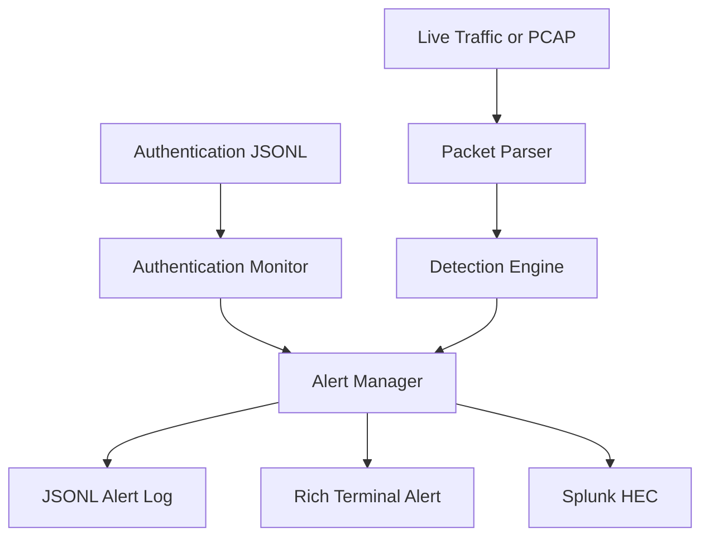

# CyberEye — Network Threat Detection and Splunk Alerting System

CyberEye is a Python-based defensive security monitoring project that analyses live network traffic, PCAP files and authentication events. It applies stateful detection rules, maps alerts to MITRE ATT&CK techniques, records Splunk-ready JSON events and optionally forwards alerts through Splunk HTTP Event Collector (HEC).

## Key Features

- Live IPv4 packet capture using Scapy and Npcap
- Offline PCAP and PCAPNG analysis
- Port-scan detection using unique-port activity
- TCP SYN-flood detection
- Suspicious inbound service-access detection
- Authentication brute-force detection
- MITRE ATT&CK technique mapping
- Severity-based terminal alerts
- Packet metadata logging in CSV format
- Security-alert logging in JSON Lines format
- Optional Splunk HEC forwarding
- Safe demonstration traffic generators
- Automated detection tests with pytest

## Detection Rules

| Detection | Severity | MITRE ATT&CK | Logic |
|---|---|---|---|
| Port Scan | High | T1046 — Network Service Discovery | Multiple unique TCP destination ports contacted within a short window |
| SYN Flood | Critical | T1498 — Network Denial of Service | High number of initial TCP SYN packets within five seconds |
| Suspicious Service Access | Medium | T1021 — Remote Services | Inbound connection attempt against monitored remote services |
| Brute Force | High | T1110 — Brute Force | Repeated authentication failures from the same source |

## Architecture



## Project Structure

```text
CyberEye-Threat-Detection-System/
├── cybereye.py
├── src/
│   ├── alerting.py
│   ├── auth_ingest.py
│   ├── auth_monitor.py
│   ├── capture.py
│   ├── config.py
│   ├── detectors.py
│   └── splunk_forwarder.py
├── tests/
│   ├── test_auth_monitor.py
│   └── test_detectors.py
├── tools/
│   ├── generate_demo_auth_log.py
│   └── generate_demo_pcap.py
├── data/
├── logs/
├── requirements.txt
├── pytest.ini
└── .env.example
```

## Installation

### Requirements

- Python 3.11 or newer
- Git
- Npcap on Windows
- Splunk Enterprise or Splunk Cloud only if HEC forwarding is required

### Setup

```powershell
git clone YOUR_REPOSITORY_URL
cd CyberEye-Threat-Detection-System
python -m venv .venv
Set-ExecutionPolicy -Scope Process -ExecutionPolicy Bypass
.\.venv\Scripts\Activate.ps1
pip install -r requirements.txt
```

Windows users should install Npcap from the official Npcap website to enable live packet capture.

## Usage

### Display Help

```powershell
python cybereye.py --help
```

### List Network Interfaces

```powershell
python cybereye.py --list-interfaces
```

### Capture Live Traffic for 30 Seconds

```powershell
python cybereye.py --timeout 30
```

### Capture Using a Specific Interface

```powershell
python cybereye.py --interface "INTERFACE_NAME" --timeout 30
```

### Analyse a PCAP File

```powershell
python cybereye.py --pcap data\demo_attack_traffic.pcap
```

### Analyse Authentication Events

```powershell
python cybereye.py --auth-log data\demo_auth_events.jsonl
```

## Safe Demonstration

The demonstration scripts create local files only. They do not transmit attack traffic onto a network.

Generate a PCAP containing normal traffic, a port-scan pattern and a SYN-flood pattern:

```powershell
python tools\generate_demo_pcap.py
python cybereye.py --pcap data\demo_attack_traffic.pcap
```

Generate synthetic successful and failed RDP authentication events:

```powershell
python tools\generate_demo_auth_log.py
python cybereye.py --auth-log data\demo_auth_events.jsonl
```

## Splunk Integration

Copy `.env.example` to `.env` and enter the Splunk HEC endpoint and token:

```env
SPLUNK_HEC_URL=https://YOUR_SPLUNK_IP:8088
SPLUNK_HEC_TOKEN=YOUR_HEC_TOKEN
SPLUNK_INDEX=cybereye
SPLUNK_VERIFY_SSL=false
```

CyberEye uses the following Splunk metadata:

```text
source=cybereye
sourcetype=cybereye:alert
index=cybereye
```

Example Splunk search:

```spl
index=cybereye sourcetype="cybereye:alert"
| stats count by event_type severity mitre_technique
```

The `.env` file is excluded from Git to prevent accidental token exposure.

## Testing

Run all automated detection tests:

```powershell
pytest -v
```

Expected result:

```text
7 passed
```

## Output Files

- `logs/packets.csv` — captured packet metadata
- `logs/alerts.jsonl` — structured security alerts suitable for Splunk ingestion

Generated logs and PCAP files are excluded from Git because they may contain local network information.

## Limitations

- CyberEye is a defensive educational project, not a replacement for a production IDS.
- Detection rules are heuristic and require tuning for each environment.
- Encrypted SSH and RDP packet contents are not decrypted.
- Brute-force detection requires authentication-failure events rather than inferring failed logins from encrypted packets.
- IPv6 analysis and application-layer inspection are not currently implemented.

## Ethical Use

Only capture, analyse or test network traffic on systems you own or have explicit permission to assess.

## Author

**Ram Siddharth Ramasamy Raja**  
MSc Applied Cyber Security, Technological University Dublin