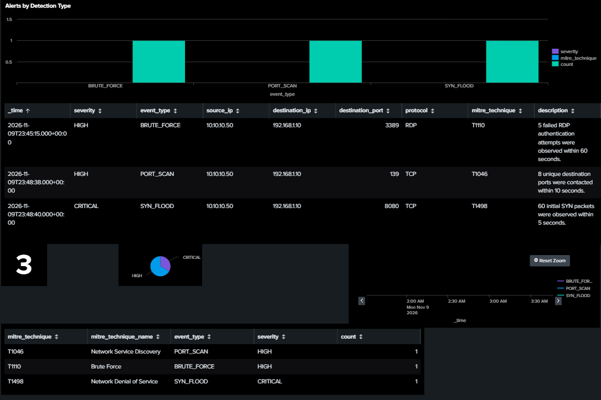
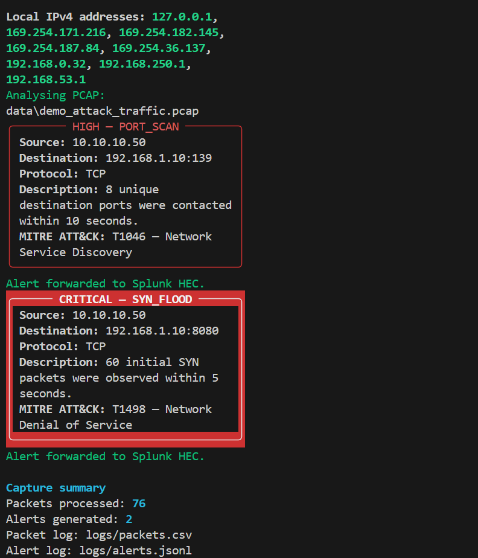
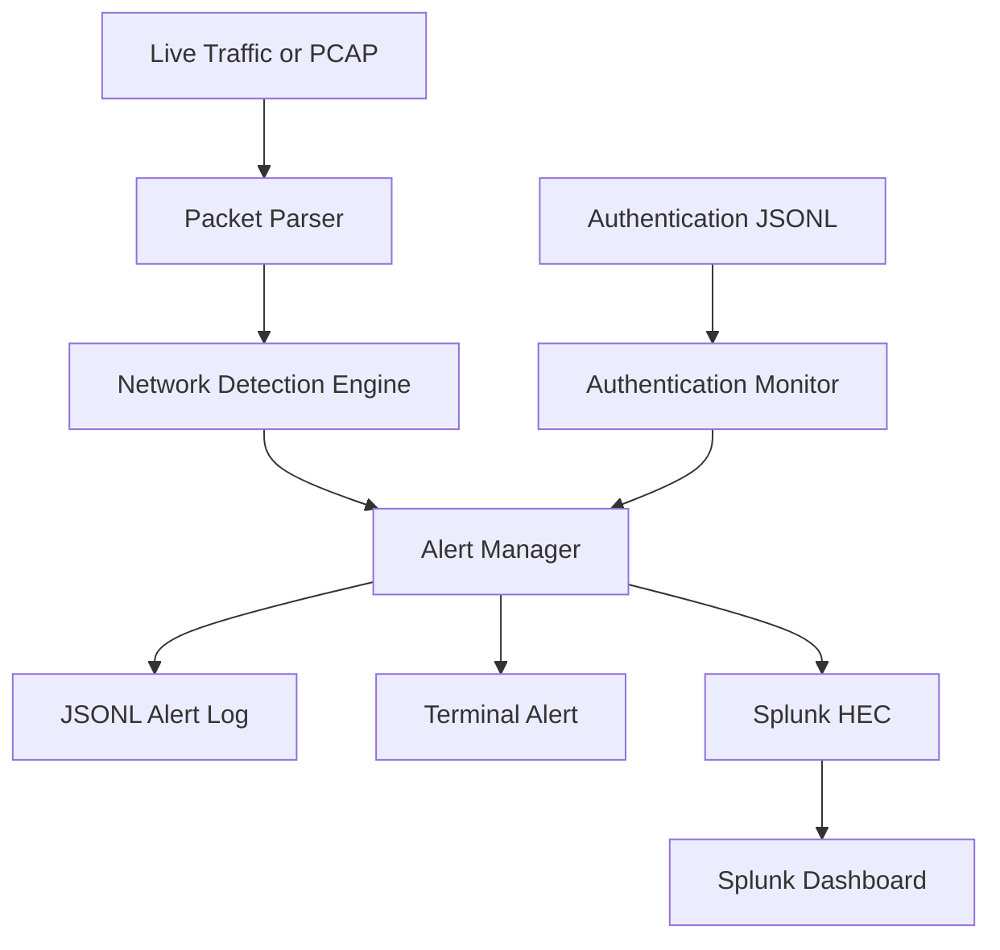

# CyberEye — Network Threat Detection and Splunk Alerting System

[](https://github.com/siddheart07/CyberEye-Threat-Detection-System/actions/workflows/tests.yml)

CyberEye is a Python-based defensive security monitoring project that analyses live network traffic, PCAP files and authentication events. It applies stateful detection rules, maps alerts to MITRE ATT&CK techniques, records structured security events and forwards alerts to Splunk through the HTTP Event Collector (HEC).

## Splunk Security Dashboard



The Splunk dashboard provides:

- Total security-alert count
- Alert severity distribution
- Detection timeline
- MITRE ATT&CK coverage
- Recent-alert investigation table

## Detection Engine Output



## Key Features

- Live IPv4 packet capture using Scapy and Npcap
- Offline PCAP and PCAPNG analysis
- Port-scan detection based on unique destination ports
- TCP SYN-flood detection
- Suspicious inbound service-access detection
- Authentication brute-force detection
- MITRE ATT&CK technique mapping
- Severity-based terminal alerts
- Packet metadata logging in CSV format
- Security-alert logging in JSON Lines format
- Real-time Splunk HEC alert forwarding
- Splunk security-monitoring dashboard
- Safe demonstration traffic generators
- Automated detection tests using pytest
- GitHub Actions continuous integration
- Alert cooldown to reduce duplicate notifications
- Environment-based secret management

## Detection Rules

| Detection | Severity | MITRE ATT&CK | Detection Logic |
|---|---|---|---|
| Port Scan | High | T1046 — Network Service Discovery | Multiple unique TCP destination ports contacted within a defined time window |
| SYN Flood | Critical | T1498 — Network Denial of Service | High number of initial TCP SYN packets observed within five seconds |
| Suspicious Service Access | Medium | T1021 — Remote Services | Inbound connection attempt against a monitored remote service |
| Brute Force | High | T1110 — Brute Force | Repeated authentication failures from the same source within 60 seconds |

## Architecture



## Project Structure

```text
CyberEye-Threat-Detection-System/
├── .github/
│   └── workflows/
│       └── tests.yml
├── cybereye.py
├── src/
│   ├── __init__.py
│   ├── alerting.py
│   ├── auth_ingest.py
│   ├── auth_monitor.py
│   ├── capture.py
│   ├── config.py
│   ├── detectors.py
│   └── splunk_forwarder.py
├── tests/
│   ├── test_auth_monitor.py
│   └── test_detectors.py
├── tools/
│   ├── generate_demo_auth_log.py
│   └── generate_demo_pcap.py
├── docs/
│   ├── cybereye-splunk-dashboard.png
│   └── cybereye-terminal-detections.png
├── data/
│   ├── .gitkeep
│   └── demo_auth_events.jsonl
├── logs/
│   └── .gitkeep
├── .env.example
├── .gitignore
├── pytest.ini
├── requirements.txt
└── README.md
```

## Requirements

- Python 3.11 or newer
- Git
- Npcap on Windows
- Splunk Enterprise or Splunk Cloud for HEC forwarding
- A Splunk HEC token and permitted index

## Installation

Clone the repository:

```powershell
git clone https://github.com/siddheart07/CyberEye-Threat-Detection-System.git
cd CyberEye-Threat-Detection-System
```

Create and activate a virtual environment:

```powershell
python -m venv .venv
Set-ExecutionPolicy -Scope Process -ExecutionPolicy Bypass
.\.venv\Scripts\Activate.ps1
```

Install the dependencies:

```powershell
pip install -r requirements.txt
```

Windows users must install Npcap to enable live packet capture.

## Usage

### Display Help

```powershell
python cybereye.py --help
```

### List Available Network Interfaces

```powershell
python cybereye.py --list-interfaces
```

### Capture Live Traffic

Capture until manually stopped:

```powershell
python cybereye.py
```

Capture for 30 seconds:

```powershell
python cybereye.py --timeout 30
```

Capture using a specific interface:

```powershell
python cybereye.py --interface "INTERFACE_NAME" --timeout 30
```

### Analyse a PCAP File

```powershell
python cybereye.py --pcap data\demo_attack_traffic.pcap
```

### Analyse Authentication Events

```powershell
python cybereye.py --auth-log data\demo_auth_events.jsonl
```

## Safe Demonstration

The demonstration scripts create local evidence files only. They do not transmit attack traffic onto a network.

### Generate Demonstration Network Traffic

This creates a PCAP containing:

- One normal HTTPS connection
- A port-scan pattern
- A SYN-flood pattern

```powershell
python tools\generate_demo_pcap.py
python cybereye.py --pcap data\demo_attack_traffic.pcap
```

Expected detections:

```text
HIGH — PORT_SCAN
CRITICAL — SYN_FLOOD
```

### Generate Demonstration Authentication Events

This creates synthetic successful and failed RDP authentication events:

```powershell
python tools\generate_demo_auth_log.py
python cybereye.py --auth-log data\demo_auth_events.jsonl
```

Expected detection:

```text
HIGH — BRUTE_FORCE
MITRE ATT&CK: T1110 — Brute Force
```

## Splunk Integration

CyberEye forwards alerts to Splunk using the HTTP Event Collector.

Copy `.env.example` to a new private file named `.env`:

```env
SPLUNK_HEC_URL=http://localhost:8088
SPLUNK_HEC_TOKEN=YOUR_PRIVATE_HEC_TOKEN
SPLUNK_INDEX=cybereye
SPLUNK_VERIFY_SSL=false
```

The `.env` file is excluded from Git to protect the HEC token.

CyberEye uses the following Splunk metadata:

```text
source=cybereye
sourcetype=cybereye:alert
index=cybereye
```

### Splunk Search — All CyberEye Alerts

```spl
index=cybereye sourcetype="cybereye:alert"
| table _time event_type severity source_ip destination_ip destination_port protocol mitre_technique description
| sort - _time
```

### Splunk Search — Alerts by Detection Type

```spl
index=cybereye sourcetype="cybereye:alert"
| stats count by event_type severity mitre_technique
```

### Splunk Search — Severity Distribution

```spl
index=cybereye sourcetype="cybereye:alert"
| stats count by severity
```

### Splunk Search — Alert Timeline

```spl
index=cybereye sourcetype="cybereye:alert"
| timechart span=1m count by event_type
```

### Splunk Search — MITRE ATT&CK Coverage

```spl
index=cybereye sourcetype="cybereye:alert"
| stats count by mitre_technique mitre_technique_name event_type severity
| sort - count
```

## Automated Testing

Run all tests:

```powershell
pytest -v
```

Expected result:

```text
7 passed
```

The test suite validates:

- Port-scan detection
- SYN-flood detection
- Suspicious inbound service detection
- Normal web-traffic handling
- Authentication brute-force detection
- Successful-login filtering
- Authentication time-window expiration

Every push and pull request is also tested automatically through GitHub Actions.

## Output Files

CyberEye generates:

```text
logs/packets.csv
logs/alerts.jsonl
```

- `packets.csv` stores captured network metadata.
- `alerts.jsonl` stores structured security alerts.
- JSON Lines events can be indexed directly or forwarded through Splunk HEC.

Generated logs and packet captures are excluded from Git because they may contain local network information.

## Security and Privacy

- HEC tokens are loaded from environment variables.
- `.env` is excluded from Git.
- Raw packet captures are excluded from Git.
- Splunk failures do not interrupt local alert logging.
- CyberEye does not decrypt SSH, RDP or other encrypted traffic.

## Limitations

- CyberEye is an educational defensive-security project, not a replacement for a production IDS.
- Detection rules are heuristic and require environment-specific tuning.
- Brute-force detection requires authentication-failure events rather than inferring failures from encrypted packets.
- IPv6 analysis and application-layer payload inspection are not currently implemented.
- Packet-capture visibility depends on the selected network interface.

## Ethical Use

Only capture, analyse or test network traffic on systems you own or have explicit permission to assess.

## Author

**Ram Siddharth Ramasamy Raja**  
MSc Applied Cyber Security  
Technological University Dublin

[GitHub Repository](https://github.com/siddheart07/CyberEye-Threat-Detection-System)